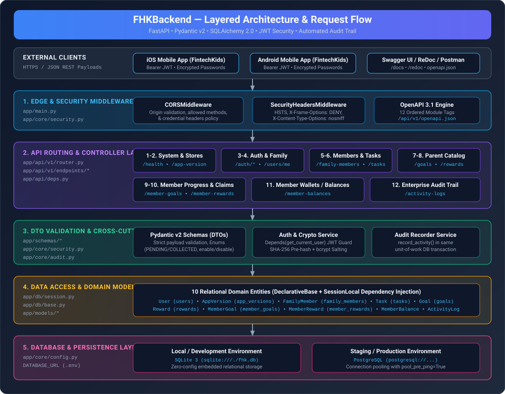
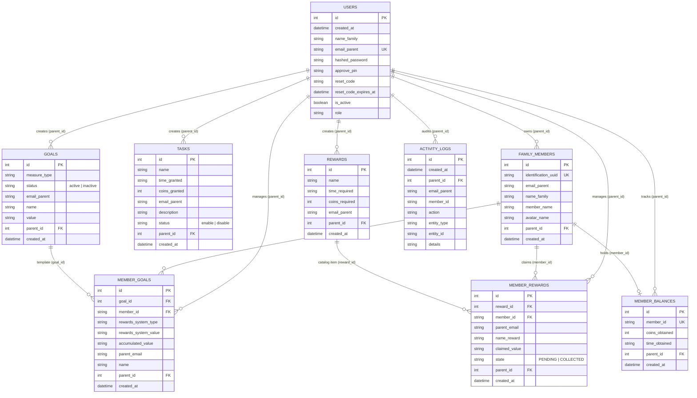
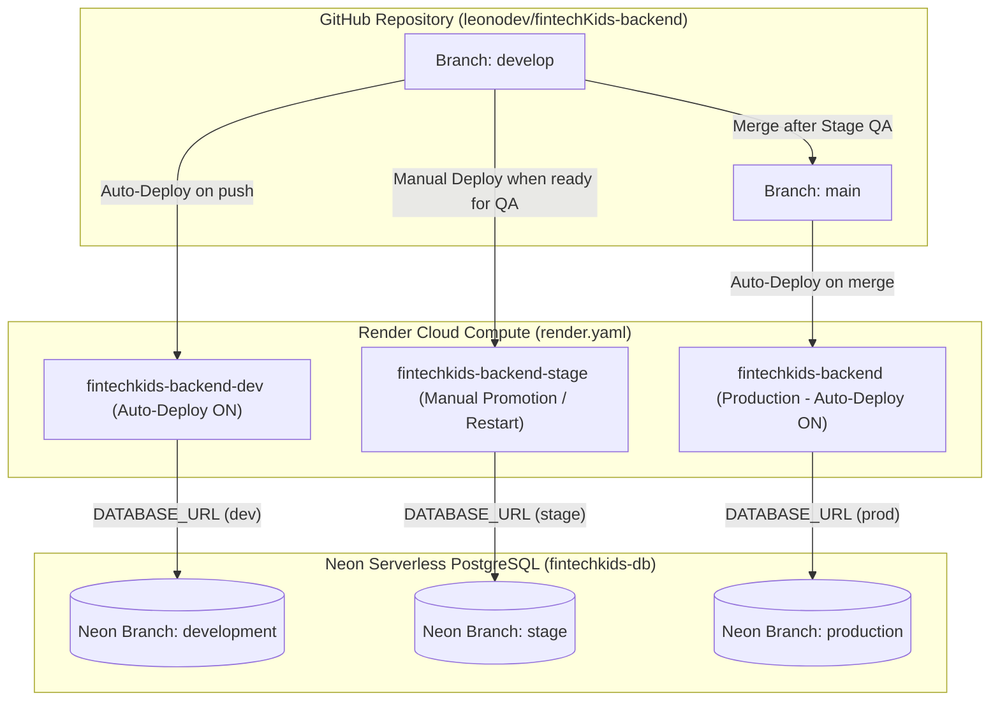

# FintechKids Backend API (`FHKBackend`)

[](https://www.python.org/)
[](https://fastapi.tiangolo.com/)
[](https://www.sqlalchemy.org/)
[](https://neon.tech/)
[](https://fintechkids-backend.onrender.com/docs)
[](./openapi.json)

Enterprise-grade RESTful API backend for **FintechKids (FHK)** — a family financial education, task management, goal tracking, and reward system platform. Built with **FastAPI**, **SQLAlchemy 2.0**, **Pydantic v2**, **JWT (Access + Refresh Tokens)**, **SHA-256 + `bcrypt` password hashing**, and an **automated enterprise audit trail**. Deployed in the cloud on **Render** and backed by **Neon Serverless PostgreSQL**.

### 🌐 Live Multi-Environment Cloud Endpoints (Render + Neon PostgreSQL)

All 3 cloud environments and the local server are pre-configured in the **Swagger UI `Servers` selector dropdown** (`/docs` and `openapi.json`):

| Environment | Git Branch | Neon DB Branch | Swagger UI (`/docs`) | Health Check (`/api/v1/health`) | ReDoc (`/redoc`) |
| :--- | :---: | :---: | :--- | :--- | :--- |
| **Development (`dev`)** | `develop` *(Auto)* | `development` | [Swagger Dev](https://fintechkids-backend-dev.onrender.com/docs) | [`/api/v1/health`](https://fintechkids-backend-dev.onrender.com/api/v1/health) | [ReDoc Dev](https://fintechkids-backend-dev.onrender.com/redoc) |
| **Stage / QA (`stage`)** | `develop` *(Manual)* | `stage` | [Swagger Stage](https://fintechkids-backend-stage.onrender.com/docs) | [`/api/v1/health`](https://fintechkids-backend-stage.onrender.com/api/v1/health) | [ReDoc Stage](https://fintechkids-backend-stage.onrender.com/redoc) |
| **Production (`prod`)** | `main` *(Auto)* | `production` | [Swagger Prod](https://fintechkids-backend.onrender.com/docs) | [`/api/v1/health`](https://fintechkids-backend.onrender.com/api/v1/health) | [ReDoc Prod](https://fintechkids-backend.onrender.com/redoc) |
| **Local (`local`)** | `develop` | `SQLite (fhk.db)` | `http://localhost:8000/docs` | `http://localhost:8000/api/v1/health` | `http://localhost:8000/redoc` |

---

## Table of Contents

1. [Layered Architecture](#1-layered-architecture)
2. [Design & Architectural Patterns](#2-design--architectural-patterns)
3. [Domain Model & Entity Relationships](#3-domain-model--entity-relationships)
4. [API Modules Catalog (Swagger / OpenAPI 3.1)](#4-api-modules-catalog-swagger--openapi-31)
5. [Project Directory Structure](#5-project-directory-structure)
6. [Required Libraries & Dependencies](#6-required-libraries--dependencies)
7. [Getting Started & Local Development](#7-getting-started--local-development)
8. [Automated Test Suite](#8-automated-test-suite)
9. [OpenAPI, Postman & Mockoon Exports](#9-openapi-postman--mockoon-exports)
10. [Cloud Deployment: Render + Neon Serverless PostgreSQL](#10-cloud-deployment-render--neon-serverless-postgresql)

---

## 1. Layered Architecture

The backend is structured around a strict **5-layer separation of concerns** so that HTTP transport, request validation, authentication, domain persistence, and cross-cutting audit trails remain decoupled and independently testable.

<p align="center">
  
</p>

### Layer Breakdown

| Layer | Responsibility | Key Files |
| :--- | :--- | :--- |
| **1. Edge & Security Middleware** | Intercepts every HTTP request/response to enforce CORS rules, inject defensive HTTP security headers (`HSTS`, `X-Frame-Options`, `X-Content-Type-Options`, `Referrer-Policy`), and serve the OpenAPI 3.1 contract. | `app/main.py`<br>`app/core/security.py` |
| **2. API Routing & Controllers** | Organizes 12 versioned feature routers under `/api/v1`, handles HTTP status codes, query filtering, and orchestrates request execution. | `app/api/v1/router.py`<br>`app/api/v1/endpoints/*.py`<br>`app/api/deps.py` |
| **3. DTO Validation & Core Services** | Validates incoming/outgoing payloads using **Pydantic v2** Data Transfer Objects (DTOs), enforces strict enums, verifies JWTs, and records audit events. | `app/schemas/*.py`<br>`app/core/security.py`<br>`app/core/audit.py` |
| **4. Data Access & ORM Models** | Maps domain entities to relational tables using **SQLAlchemy 2.0** declarative mappings, foreign keys, cascades, and indexed lookups. | `app/db/base.py`<br>`app/db/session.py`<br>`app/models/*.py` |
| **5. Persistence Engine** | Abstracts the underlying relational database engine: embedded **SQLite** (`sqlite:///./fhk.db`) for local development/CI and **Neon Serverless PostgreSQL** (`postgresql+psycopg2://...`) in cloud production on **Render**. | `app/core/config.py`<br>`app/db/session.py`<br>`render.yaml` |

---

## 2. Design & Architectural Patterns

### 1. Dependency Injection (DI)
FastAPI's `Depends()` mechanism is used systematically to inject:
- **Database Sessions (`get_db`)**: Provides a scoped SQLAlchemy `SessionLocal` per request and guarantees cleanup (`db.close()`) in a `finally` block.
- **Authentication Context (`get_current_user`)**: Decodes the bearer token, verifies token type (`access`), queries the active `User` entity, and injects the authenticated parent account directly into protected endpoints.

### 2. Data Transfer Object (DTO) Pattern
Database models (`app/models/`) are never exposed directly in API responses. Instead, each module defines dedicated **Pydantic v2 schemas** (`app/schemas/`):
- `*Create`: Input payload contract (with server-generated `created_at` UTC timestamps excluded from client input).
- `*Update`: Partial update payload contract (`PATCH`) where all mutable attributes are optional.
- `*Response`: Output serialization contract with `ConfigDict(from_attributes=True)`.

### 3. Multi-Tenant Family Scoping (Ownership Isolation)
Every resource (`FamilyMember`, `Task`, `Goal`, `Reward`, `MemberGoal`, `MemberReward`, `MemberBalance`, `ActivityLog`) is cryptographically and relationally bound to the authenticated parent (`current_user.id` and `current_user.email_parent`).
- Even if a client sends a different `email_parent` in the request body or attempts to access another family's entity ID, the controller validates ownership against the JWT subject and returns `403 Forbidden` or `404 Not Found`.

### 4. Transactional Audit Trail (Unit-of-Work Logging)
All write operations (`CREATE`, `UPDATE`, `DELETE`, `LOGIN`, `PASSWORD_RESET`, `COLLECT_REWARD`, etc.) invoke `record_activity()` (`app/core/audit.py`) **before** `db.commit()`.
- The business state change and the corresponding `ActivityLog` entry are flushed inside the **exact same database transaction**, ensuring 100% audit consistency without orphaned logs.

### 5. Dual-Stage Password Cryptography (SHA-256 + `bcrypt`)
To support arbitrarily long client-encrypted password strings from mobile apps without hitting `bcrypt`'s 72-byte truncation limit:
1. The backend first normalizes the incoming password through `SHA-256` (producing a 64-character hex digest).
2. The digest is then salted and hashed with `bcrypt` before persisting to `users.hashed_password`.

### 6. Dual-Scheme Bearer Authentication in OpenAPI
`app/api/deps.py` combines `HTTPBearer` (enabling simple token paste in Swagger UI) and `OAuth2PasswordBearer` (enabling username/password login directly inside the Swagger **"Authorize"** modal), giving developers and QA testers seamless interactive testing.

---

## 3. Domain Model & Entity Relationships

All timestamps (`created_at`, `updated_at`) are automatically generated in **UTC** on the backend (`datetime.now(timezone.utc)`).



---

## 4. API Modules Catalog (Swagger / OpenAPI 3.1)

The OpenAPI specification is organized into **12 sequential modules**:

| # | Swagger Tag | Base Path | Endpoints & Operations | Auth |
| :-: | :--- | :--- | :--- | :-: |
| **1** | **1. Server Status** | `/api/v1/health` | `GET /api/v1/health` — Health check & active environment | Public |
| **2** | **2. App Version (Stores)** | `/api/v1/app-version` | `GET /check?platform=IOS\|AND&current_version=...`<br>`GET /` — List store versions<br>`PUT /{platform}` — Upsert store version rule | Public<br>Public<br>JWT |
| **3** | **3. Authentication** | `/api/v1/auth` | `POST /register` — Register family account<br>`POST /login` — Obtain access & refresh tokens<br>`POST /forgot-password` — Generate 6-digit recovery code<br>`POST /reset-password` — Reset password with code<br>`POST /refresh` — Refresh JWT pair | Public |
| **4** | **4. Users / Family** | `/api/v1/users` | `GET /me` — Get authenticated parent profile<br>`PATCH /me` — Update family name, PIN, or password | JWT |
| **5** | **5. Family Members** | `/api/v1/family-members` | `POST /` — Register a family member (`identification_uuid`)<br>`GET /` — List all family members<br>`PATCH /{identification_uuid}` — Update member<br>`DELETE /{identification_uuid}` — Delete member | JWT |
| **6** | **6. Family Tasks** | `/api/v1/tasks` | `POST /` — Create family task (defaults to `enable`)<br>`PATCH /{task_id}` — Edit task or toggle `enable`/`disable`<br>`GET /` — List all family tasks (any status)<br>`GET /enabled` — List only enabled tasks<br>`DELETE /{task_id}` — Delete family task | JWT |
| **7** | **7. Parent Goals** | `/api/v1/goals` | `POST /` — Create goal template (`active`/`inactive`)<br>`GET /` — List parent goals<br>`PATCH /{goal_id}` — Update goal<br>`DELETE /{goal_id}` — Delete goal | JWT |
| **8** | **8. Parent Rewards** | `/api/v1/rewards` | `POST /` — Create reward catalog item<br>`GET /` — List parent rewards<br>`PATCH /{reward_id}` — Update reward<br>`DELETE /{reward_id}` — Delete reward | JWT |
| **9** | **9. Member Goals** | `/api/v1/member-goals` | `POST /` — Assign goal to a family member<br>`GET /` — List member goals (filterable by `member_id`)<br>`PATCH /{member_goal_id}` — Update accumulated progress<br>`DELETE /{member_goal_id}` — Delete member goal | JWT |
| **10** | **10. Member Rewards** | `/api/v1/member-rewards` | `POST /` — Claim a reward (`PENDING` or `COLLECTED`)<br>`GET /` — List claimed rewards (filterable by `member_id`, `state`)<br>`PATCH /{member_reward_id}` — Mark as `COLLECTED`<br>`DELETE /{member_reward_id}` — Delete claimed reward | JWT |
| **11** | **11. Member Balances** | `/api/v1/member-balances` | `POST /` — Create or update member balance (coins & time)<br>`GET /` — List balances for all family members<br>`GET /{member_id}` — Get balance for a single member<br>`PATCH /{member_id}` — Partially update member balance | JWT |
| **12** | **12. Activity History (Audit Logs)** | `/api/v1/activity-logs` | `GET /` — Paginated audit trail (filterable by `member_id`, `entity_type`, `action`, `limit`, `offset`) | JWT |

---

## 5. Project Directory Structure

```text
FHKBackend/
├── app/
│   ├── main.py                      # FastAPI application entrypoint, middlewares & OpenAPI metadata
│   ├── api/
│   │   ├── deps.py                  # JWT authentication dependencies (HTTPBearer + OAuth2)
│   │   └── v1/
│   │       ├── router.py            # Main API v1 router aggregating all 12 ordered modules
│   │       └── endpoints/           # Route controllers per domain module
│   │           ├── activity_logs.py
│   │           ├── app_version.py
│   │           ├── auth.py
│   │           ├── family_members.py
│   │           ├── goals.py
│   │           ├── member_balances.py
│   │           ├── member_goals.py
│   │           ├── member_rewards.py
│   │           ├── rewards.py
│   │           ├── tasks.py
│   │           └── users.py
│   ├── core/
│   │   ├── audit.py                 # Transactional activity audit logger (record_activity)
│   │   ├── config.py                # Pydantic Settings (.env loader)
│   │   └── security.py              # SHA-256 + bcrypt hashing, PyJWT tokens, SecurityHeadersMiddleware
│   ├── db/
│   │   ├── base.py                  # SQLAlchemy 2.0 DeclarativeBase
│   │   └── session.py               # Database engine & SessionLocal dependency
│   ├── models/                      # SQLAlchemy 2.0 relational models (10 tables)
│   └── schemas/                     # Pydantic v2 request/response DTOs & Enums
├── docs/
│   └── architecture.svg             # Layered architecture vector diagram
├── mockoon/
│   └── FHKBackend.mockoon.json      # Mockoon Desktop environment (12 folders, 41 routes, 3000ms delay)
├── postman/
│   ├── FHKBackend.postman_collection.json   # Ready-to-import Postman v2.1 Collection (12 modules)
│   └── FHKBackend.postman_environment.json  # Ready-to-import Postman Environment variables
├── scripts/
│   ├── export_openapi.py            # CLI utility to export openapi.json
│   ├── generate_mockoon.py          # CLI utility to generate Mockoon environment JSON
│   └── generate_postman.py          # CLI utility to generate Postman files & seed demo data
├── tests/
│   └── test_api.py                  # End-to-end integration & security test suite (pytest)
├── openapi.json                     # Auto-generated OpenAPI 3.1 contract
├── pytest.ini                       # Pytest configuration
├── render.yaml                      # Render Cloud Blueprint configuration
└── requirements.txt                 # Pinned Python dependencies (including psycopg2-binary)
```

---

## 6. Required Libraries & Dependencies

All project dependencies are defined in [`requirements.txt`](./requirements.txt) and installed automatically via `pip install -r requirements.txt`:

| Library / Package | Version Constraint | Role in the Architecture |
| :--- | :--- | :--- |
| **`fastapi`** | `>=0.110.0,<1.0.0` | High-performance ASGI web framework, dependency injection (`Depends`), and automatic OpenAPI 3.1 generation. |
| **`uvicorn[standard]`** | `>=0.29.0,<1.0.0` | Lightning-fast ASGI web server (`uvloop` + `httptools`) used to serve the FastAPI application locally and on Render. |
| **`sqlalchemy`** | `>=2.0.29,<3.0.0` | Enterprise ORM (`DeclarativeBase`, `SessionLocal`, relational mappings, foreign keys, and connection pooling). |
| **`psycopg2-binary`** | `>=2.9.9,<3.0.0` | Native PostgreSQL DBAPI driver (`postgresql+psycopg2://`) required for connecting SQLAlchemy to **Neon Serverless PostgreSQL** on **Render**. |
| **`pydantic`** | `>=2.7.0,<3.0.0` | Strict data validation, serialization, DTO schemas (`*Create`, `*Update`, `*Response`), and Enum enforcement. |
| **`pydantic-settings`** | `>=2.2.1,<3.0.0` | Twelve-Factor environment variable management (`app/core/config.py`) loading from `.env` or cloud environment variables. |
| **`email-validator`** | `>=2.1.1,<3.0.0` | RFC-compliant validation for `EmailStr` fields (`email_parent` and `parent_email`). |
| **`PyJWT`** | `>=2.8.0,<3.0.0` | Cryptographic signing (`HS256`), decoding, and expiration validation of `access_token` and `refresh_token` JWTs. |
| **`bcrypt`** | `>=4.1.2,<5.0.0` | Salted password hashing (12 rounds) applied over SHA-256 pre-hashed client passwords. |
| **`python-multipart`** | `>=0.0.9,<1.0.0` | Form-data parsing required by FastAPI's `OAuth2PasswordBearer` interactive Swagger login flow. |
| **`httpx`** | `>=0.27.0,<1.0.0` | HTTP client powering FastAPI's `TestClient` for integration testing. |
| **`pytest`** | `>=8.1.1,<9.0.0` | Automated test runner for executing the end-to-end API and security test suite (`tests/test_api.py`). |

---

## 7. Getting Started & Local Development

### Prerequisites
- **Python 3.9+** (or **Python 3.11** in cloud production)
- **Virtual environment (`venv`)**

### Installation & Startup

```bash
# 1. Clone the repository
git clone https://github.com/leonodev/fintechKids-backend.git
cd fintechKids-backend

# 2. Create and activate the virtual environment
python3 -m venv .venv
source .venv/bin/activate

# 3. Install dependencies
pip install -r requirements.txt

# 4. Configure environment variables (optional in dev; defaults provided)
cp .env.example .env

# 5. Start the development server with hot-reload
uvicorn app.main:app --reload --host 0.0.0.0 --port 8000
```

### Interactive Documentation Endpoints
Once the server is running, open in your browser:
- **Local Swagger UI**: `http://localhost:8000/docs`
- **Cloud Swagger UI (Render)**: `https://fintechkids-backend.onrender.com/docs`
- **Local Health Check**: `http://localhost:8000/api/v1/health`
- **Cloud Health Check (Render)**: `https://fintechkids-backend.onrender.com/api/v1/health`

---

## 8. Automated Test Suite

The project includes an end-to-end integration test suite (`tests/test_api.py`) using `pytest` and `fastapi.testclient.TestClient` that validates:
- Health & store version comparison logic (`IOS` & `AND`)
- Family registration, login, JWT refresh, and 6-digit password recovery flow
- Unauthorized access rejection (`401 Unauthorized` without valid Bearer JWT)
- Full CRUD lifecycles across `family-members`, `tasks`, `goals`, `rewards`, `member-goals`, `member-rewards`, and `member-balances`
- Strict enum validation (e.g., rejecting invalid states outside `PENDING` and `COLLECTED`)
- Automatic audit trail generation in `GET /api/v1/activity-logs`

```bash
pytest -v
```

---

## 9. OpenAPI, Postman & Mockoon Exports

Whenever endpoints or Pydantic schemas are modified, you can export the static `openapi.json` file at the root of the repository:

```bash
python3 scripts/export_openapi.py
```

### Postman Collection & Multi-Environment Files (`postman/`)
A ready-to-import Postman v2.1 Collection and 4 Environment files (`Local`, `Development`, `Stage`, and `Production`) with pre-configured Bearer JWT (`{{access_token}}`), global variables, and automatic post-response variable capture scripts are included in the `postman/` directory:
- [`postman/FHKBackend.postman_collection.json`](./postman/FHKBackend.postman_collection.json) — Complete 12-Module Collection
- [`postman/FHKBackend.postman_environment.json`](./postman/FHKBackend.postman_environment.json) — Local (`http://localhost:8000`)
- [`postman/FHKBackend.dev.postman_environment.json`](./postman/FHKBackend.dev.postman_environment.json) — Development (`https://fintechkids-backend-dev.onrender.com`)
- [`postman/FHKBackend.stage.postman_environment.json`](./postman/FHKBackend.stage.postman_environment.json) — Stage (`https://fintechkids-backend-stage.onrender.com`)
- [`postman/FHKBackend.prod.postman_environment.json`](./postman/FHKBackend.prod.postman_environment.json) — Production (`https://fintechkids-backend.onrender.com`)

```bash
python3 scripts/generate_postman.py
```

### Mockoon Desktop Environment (`mockoon/`)
A complete Mockoon Desktop environment covering all 12 modules and 41 routes with a `3000 ms` loader delay and pre-built scenarios for Success (`200`/`201`), Errors (`400`, `401`, `403`, `404`, `422`, `500`), and Timeouts (`408` at `15000 ms` and `504` at `35000 ms`) is included in the `mockoon/` directory:
- [`mockoon/FHKBackend.mockoon.json`](./mockoon/FHKBackend.mockoon.json)

```bash
python3 scripts/generate_mockoon.py
```

---

## 10. Cloud Deployment: Render + Neon Serverless PostgreSQL

The project is deployed in the cloud using a **3-environment (`development`, `stage`, `production`), 100% non-expiring Free Tier architecture** combining **GitHub** (`develop` and `main` branches), **Render** (3 isolated Web Services defined in [`render.yaml`](./render.yaml)), and **Neon** (3 isolated Serverless PostgreSQL database branches):



### Multi-Environment Matrix (Render + Neon)

| Environment | Git Branch | Render Service Name | Deploy Trigger | Neon DB Branch | `ENVIRONMENT` Var |
| :--- | :---: | :--- | :--- | :--- | :---: |
| **Development** | `develop` | `fintechkids-backend-dev` | **Automatic** on every `git push origin develop` | `development` | `development` |
| **Stage (QA)** | `develop` | `fintechkids-backend-stage` | **Manual Deploy / Restart** when `develop` is ready for QA | `stage` | `stage` |
| **Production** | `main` | `fintechkids-backend` | **Automatic** on merge from `develop` to `main` | `production` | `production` |

### 1. Compute Layer — Render (`render.yaml`)
- **Blueprint Configuration**: [`render.yaml`](./render.yaml) declares all 3 services (`fintechkids-backend-dev`, `fintechkids-backend-stage`, `fintechkids-backend`) on Python `3.11.9`, runs `pip install -r requirements.txt` during build, starts the ASGI server with `uvicorn app.main:app --host 0.0.0.0 --port $PORT`, and monitors `/api/v1/health`.

### 2. Database Layer — Neon Serverless PostgreSQL (`app/db/session.py`)
- **Database Branching**: [Neon (`neon.tech`)](https://neon.tech/) supports isolated PostgreSQL branches (`development`, `stage`, `production`) inside the `fintechkids-db` project, each with its own connection string (`-pooler`) and TLS encryption (`sslmode=require&channel_binding=require`).
- **Automatic Driver Scheme Normalization**: Because SQLAlchemy 2.1+ defaults bare `postgresql://` URLs to `psycopg` (v3), [`app/db/session.py`](./app/db/session.py) automatically normalizes any `postgres://` or `postgresql://` connection string into `postgresql+psycopg2://` so the `psycopg2-binary` driver is always used seamlessly:
  ```python
  db_url = settings.DATABASE_URL
  if db_url.startswith("postgres://"):
      db_url = db_url.replace("postgres://", "postgresql+psycopg2://", 1)
  elif db_url.startswith("postgresql://"):
      db_url = db_url.replace("postgresql://", "postgresql+psycopg2://", 1)
  ```
- **Automatic Schema Provisioning**: On application startup in each environment, FastAPI's `lifespan` hook in [`app/main.py`](./app/main.py) runs `Base.metadata.create_all(bind=engine)`, automatically creating all 10 tables in the `public` schema of the connected Neon branch (`users`, `app_versions`, `family_members`, `tasks`, `goals`, `rewards`, `member_goals`, `member_rewards`, `member_balances`, and `activity_logs`) if they do not yet exist.

### 3. Environment Variables Configured per Render Service
In **Render Dashboard → Service → Environment**:

```env
PYTHON_VERSION="3.11.9"
ENVIRONMENT="development" # or "stage" / "production"
SECRET_KEY="<auto-generated-by-render>"
DATABASE_URL="postgresql://<user>:<password>@<branch-endpoint>-pooler.<region>.aws.neon.tech/<dbname>?sslmode=require&channel_binding=require"
```
